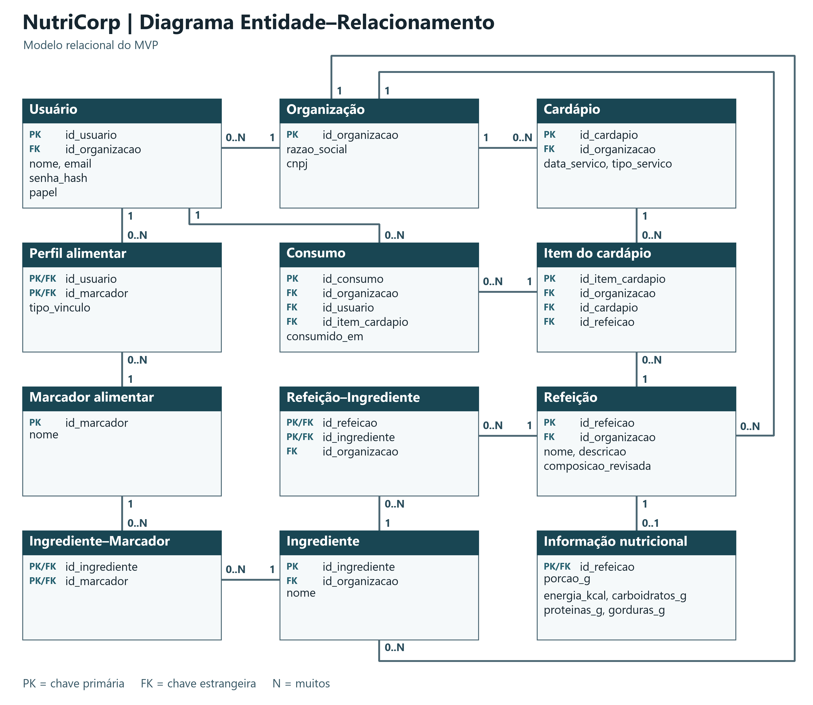

# Modelagem de Dados

A camada de dados do NutriCorp foi modelada para PostgreSQL. O Diagrama Entidade–Relacionamento (DER) apresenta as 12 entidades do Produto Mínimo Viável (MVP), seus principais atributos e as cardinalidades dos relacionamentos. PK indica chave primária, FK indica chave estrangeira e N representa muitos.

**Figura — Diagrama Entidade–Relacionamento do NutriCorp**

*Fonte — Elaborado pelo grupo.*

## Entidades e relacionamentos

- **Organização e Usuário.** Cada usuário pertence a uma organização e tem um papel de acesso (colaborador, cozinha ou RH). Uma organização pode ter vários usuários, cardápios, refeições e ingredientes.
- **Cardápio, Item do Cardápio e Refeição.** O cardápio registra a data e o tipo de serviço, como almoço ou jantar. O item vincula uma refeição a um cardápio. Assim, um cardápio pode oferecer várias refeições, e uma refeição pode ser oferecida em diferentes cardápios da mesma organização.
- **Ingrediente, Refeição–Ingrediente e Informação Nutricional.** Refeições e ingredientes se relacionam de muitos para muitos por meio de Refeição–Ingrediente. Uma refeição pode ter até uma ficha nutricional, com a porção em gramas e os valores disponíveis de energia, carboidratos, proteínas e gorduras.
- **Marcador Alimentar, Ingrediente–Marcador e Perfil Alimentar.** Marcadores como lactose identificam componentes relevantes na alimentação. Ingrediente–Marcador associa ingredientes a marcadores. Perfil Alimentar relaciona um colaborador aos marcadores que ele cadastrou voluntariamente como preferência ou restrição, com um tipo de vínculo por marcador.
- **Consumo.** Cada registro associa um colaborador a um item do cardápio e guarda a data e a hora do consumo. Essa associação forma o histórico alimentar do colaborador e serve de base para indicadores agregados de consumo.

## Integridade dos dados

As chaves estrangeiras compostas impedem que cardápios, refeições, ingredientes, usuários e consumos sejam vinculados indevidamente entre organizações. O back-end deve controlar o acesso aos registros individuais e disponibilizar indicadores agregados aos perfis de RH e cozinha.

Para identificar incompatibilidades, a aplicação deve cruzar os marcadores das restrições do colaborador com os marcadores dos ingredientes da refeição. Quando as informações sobre a composição estiverem incompletas ou pendentes de revisão, a aplicação deve indicar que os dados são insuficientes para concluir a análise.

## Migrações

A estrutura inicial está versionada em duas migrações SQL. A primeira cria o esquema `nutricorp`, as organizações, os usuários e os catálogos de refeições, ingredientes e marcadores. A segunda cria os cardápios e seus itens, as associações da composição, as fichas nutricionais, os perfis alimentares e os registros de consumo. A ordem respeita as dependências entre as chaves estrangeiras. O procedimento de aplicação em um banco vazio está descrito em `database/README.md` no repositório.
